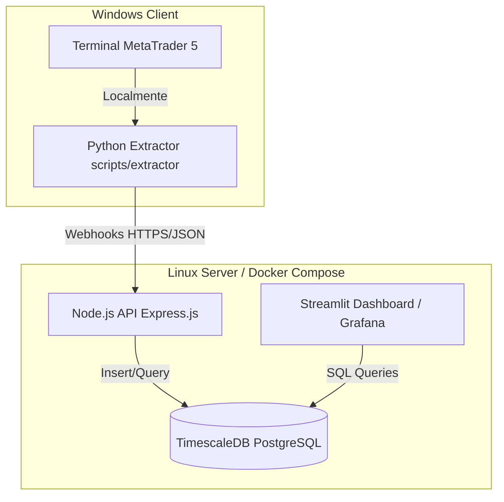

# Arquitectura de la Infraestructura en Linux: DB y Servidor

Este documento describe la arquitectura técnica, el diseño de la base de datos y la orquestación de servicios en el servidor Linux para el ecosistema **CRT Quant**.

---

## 1. Diagrama de Flujo de Datos



---

## 2. El Servidor e Infraestructura (Linux)

Para garantizar la portabilidad, el aislamiento de procesos y la facilidad de despliegue en un entorno de producción Linux, el sistema utiliza **Docker** y **Docker Compose**.

*   **Aislamiento con Docker:** Cada componente del sistema (API Node.js, TimescaleDB, herramientas analíticas) corre en su propio contenedor seguro.
*   **Orquestación (`docker-compose.yml`):** Gestiona tres servicios clave de forma coordinada:
    1.  `node_api`: Servidor HTTP de ingesta.
    2.  `postgres_db`: Base de datos relacional y de series temporales.
    3.  `grafana` / `streamlit`: Herramientas visuales de análisis de datos.
*   **Persistencia Física:** Utiliza volúmenes de Docker vinculados a directorios del sistema de archivos de Linux, asegurando que la base de datos no pierda información ante paradas o reinicios del contenedor.

---

## 3. La API de Ingesta (Node.js & Express)

Ubicada en el backend de Linux, es la encargada de recibir la telemetría de los setups y trades de MetaTrader 5.
*   **Estándares de Código:**
    *   Arquitectura basada en **ES6 Modules** (`import`/`export`).
    *   Estructura limpia siguiendo el patrón **MVC** (Rutas -> Controladores -> Servicios).
    *   Toda comunicación directa con la base de datos ocurre exclusivamente en la capa de **Servicios**.
    *   Uso exclusivo de estructuras `async/await` para el código asíncrono.
*   **Seguridad y Validación:**
    *   Payloads validados mediante esquemas robustos (ej. **Zod**) antes de realizar la inserción a la base de datos.
    *   Campos dinámicos del JSONB inicializados por defecto con objetos vacíos `{}` para evitar excepciones nulas en tiempo de ejecución.

---

## 4. Base de Datos (TimescaleDB / PostgreSQL)

Los datos de trading representan series temporales complejas. Para optimizar el almacenamiento y permitir la consulta rápida de millones de registros, se utiliza **TimescaleDB** integrado en PostgreSQL.

### Esquema de la Tabla Principal: `crt_trades`

```sql
CREATE EXTENSION IF NOT EXISTS timescaledb;

CREATE TABLE crt_trades (
    id UUID PRIMARY KEY DEFAULT gen_random_uuid(),
    symbol VARCHAR(10) NOT NULL,            
    timeframe VARCHAR(5) NOT NULL,          
    direction VARCHAR(10) NOT NULL,         
    
    -- Tiempos (Eje temporal de TimescaleDB)
    entry_time TIMESTAMPTZ NOT NULL,        
    exit_time TIMESTAMPTZ,                  
    
    -- Anatomía del Rango Local
    base_high NUMERIC NOT NULL,
    base_low NUMERIC NOT NULL,
    trigger_extreme NUMERIC NOT NULL,       
    
    -- Métricas del Setup Local
    sweep_count INT DEFAULT 1,              
    has_restarted BOOLEAN DEFAULT FALSE,    
    hit_50_percent BOOLEAN DEFAULT FALSE,   
    
    -- Resultado y Excursión
    result_type VARCHAR(20) NOT NULL,       
    mae NUMERIC,                            
    mfe NUMERIC,                            
    
    -- Escalabilidad Semántica (Dinámica)
    htf_context JSONB DEFAULT '{}'::jsonb,  
    metadata JSONB DEFAULT '{}'::jsonb,     
    
    created_at TIMESTAMPTZ DEFAULT NOW()
);

-- Conversión de la tabla a Hipertabla de TimescaleDB
SELECT create_hypertable('crt_trades', 'entry_time');
```

### Características Críticas del Diseño de Base de Datos:

1.  **Hipertabla temporal (TimescaleDB):** La instrucción `create_hypertable` particiona automáticamente la tabla física en el disco de Linux en función de la columna `entry_time`. Esto garantiza tiempos de respuesta rápidos y constantes sin importar la antigüedad o el tamaño total de la base de datos.
2.  **Flexibilidad Multitemporal (`htf_context` JSONB):** Permite almacenar confluencias de marcos temporales mayores en tiempo de ejecución (ej. `{"D1_bias": "BULL", "H4_state": "MANIPULATION"}`) sin necesidad de alterar el esquema relacional rígido.
3.  **Campos de Excursión (`mae` / `mfe`):** Mide con precisión el riesgo recorrido contra el beneficio potencial de cada operación para un análisis de drawdown cuantitativo.
4.  **Indexación:**
    *   Índices compuestos en `(symbol, timeframe)` para búsquedas rápidas por activos.
    *   **Índice GIN especial** en `htf_context` (`CREATE INDEX idx_crt_htf_context ON crt_trades USING GIN (htf_context);`), lo que habilita la consulta indexada instantánea dentro de las propiedades de los objetos dinámicos guardados en el servidor.
